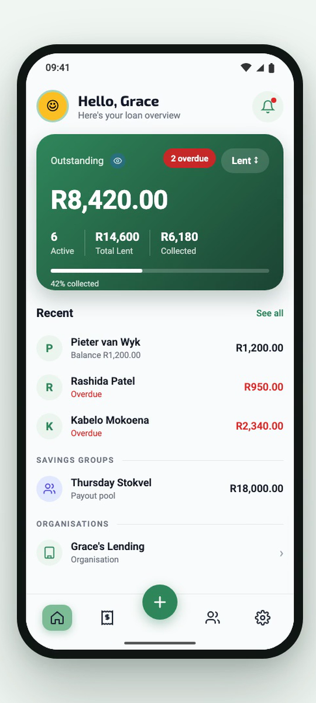
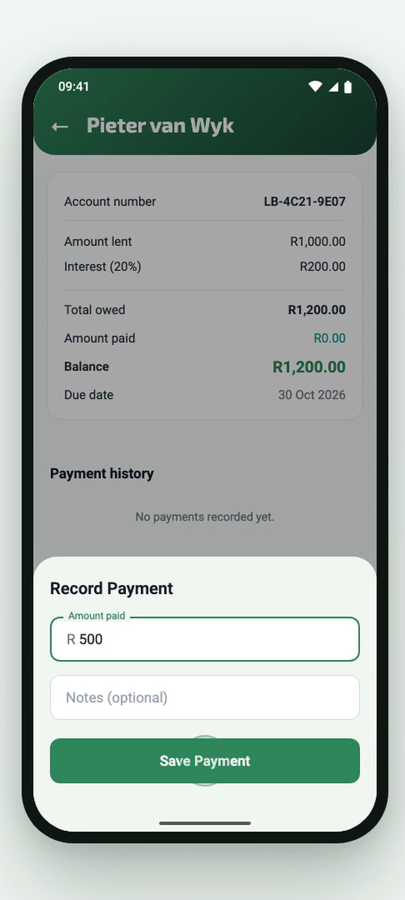
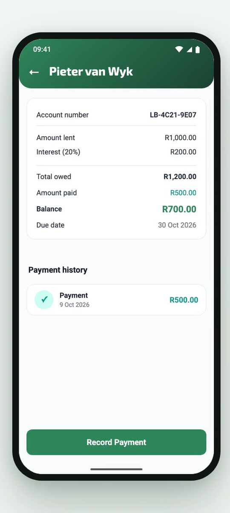
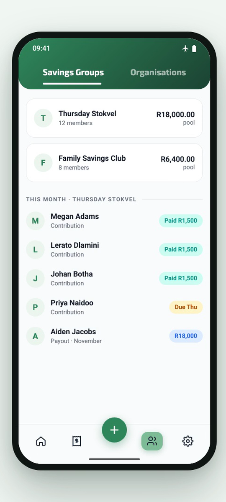
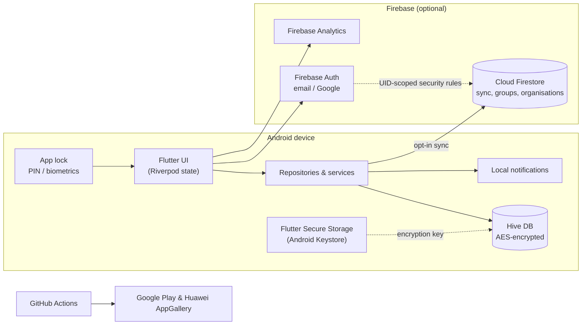

# Loan Book

**Track money you lend and money you save together. Offline, free, built for how South Africans actually lend.**

Loan Book is a free Android app for informal lending and savings: money lent to family and friends, small community lenders, and stokvels. It is live on Google Play and Huawei AppGallery with 5,000+ downloads.

Download it on [Google Play](https://play.google.com/store/apps/details?id=com.siyabulela.loanbook) or [Huawei AppGallery](https://appgallery.huawei.com/app/C117029041).

Entry by team **Vela Labs** for the **FNB App of the Year Hackathon 2026**, challenge: *Financial inclusion and money confidence*.

| Dashboard | Record a payment | Balance updates | Stokvels |
|---|---|---|---|
|  |  |  |  |

*Screens shown with sample data.*

## The problem

Millions of South Africans lend money informally or save in stokvels, and most of it is tracked in a notebook or from memory. Pages get lost, part-payments are hard to add up, and when someone says "I already paid you" it is one person's handwriting against another's word. Existing finance apps are built for banks and salaried users with bank accounts, not for informal lenders and savings groups.

## What Loan Book does

- **Loans:** amount, interest and due date, with payments recorded as they come in. The balance, overdue status and per-borrower history update automatically.
- **Reminders:** local notifications before payments are due.
- **Stokvels and savings groups:** members, contributions, payouts, plus flexible savings where members choose their own amount.
- **Organisations:** small lending groups share one loan book with their members.
- **Reports:** monthly summaries of money out and money back.
- **Offline-first:** everything works without data. Cloud sign-in and backup are optional.
- **Private by default:** data stays on the phone, encrypted and locked with a PIN or fingerprint.

## Architecture

- **Local first:** Hive is the source of truth on the device. Firestore is only used when the user signs in and turns on sync, or uses shared features (groups and organisations).
- **Encryption at rest:** the Hive database is encrypted with a key held in Flutter Secure Storage, backed by the Android Keystore.
- **Access control:** Firestore security rules check the signed-in user's UID, so users can only read and write their own data and the groups or organisations they belong to.
- **Releases:** GitHub Actions builds signed releases for Google Play and Huawei AppGallery.

## Tech stack

Flutter and Dart, Riverpod, Hive (encrypted), Flutter Secure Storage, Firebase Authentication, Cloud Firestore, Firebase Analytics, Flutter Local Notifications, Local Auth, Syncfusion Charts and GitHub Actions.

## Security and responsible lending

Our full SSDLC plan is part of the hackathon submission.

**In the app today:** encrypted local database, PIN and biometric app lock, auto-lock after a set time, UID-scoped Firestore rules, and cloud sync that is off unless the user turns it on.

**Planned in our SSDLC:**

- PIN brute-force lockout, a shuffled PIN keypad and a blank screen in Recent Apps
- Two-factor authentication for cloud accounts
- POPIA: borrower data is never shared with third parties, and any future data sharing is strictly opt-in
- Loan Book is a record-keeping tool, not a lender. We are adding a "Lend Responsibly" guide covering NCR registration, legal interest-rate limits and fair debt collection.

## Hackathon progress

Loan Book existed before the hackathon. Work done for FNB App of the Year Hackathon 2026 (23 to 26 October 2026):

- [x] Team profile, pitch video and SSDLC security plan
- [x] Reviewed mentor feedback on responsible lending and stokvel visibility
- [ ] New feature: "Lend Responsibly" guide and interest-rate warning (in progress)
- [ ] Lean Business Canvas, slides and signed APK for judges

## Source code

Loan Book is a live product, so its source repository is private. **Full source is available to judges on request.**

---

Built by [Vela Labs](https://velalabs.co.za) in KwaDukuza, KwaZulu-Natal.
